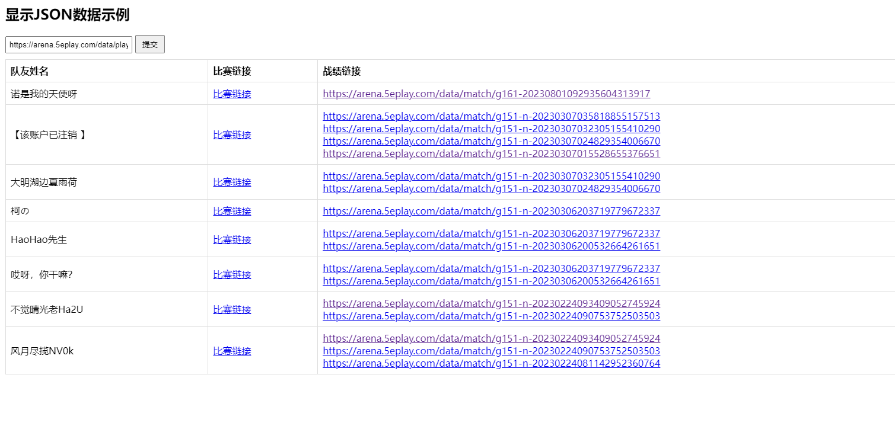
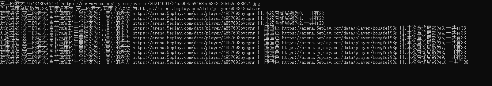

# 5E 对局查询工具

🎮 查询 5E 平台玩家对局信息和开黑队友。

[](https://github.com/jwwsjlm/5eplay_buddy_Inquire/releases)
[](LICENSE)
[](https://golang.org)

---

## ✨ 功能特性

- 🔍 **玩家查询** - 通过个人主页查询玩家信息
- 👥 **开黑队友** - 查询一起开黑的玩家
- 🌐 **Web 界面** - 可视化操作，简单易用
- ⚡ **实时数据** - 从 5E 平台实时获取

---

## 🚀 快速开始

### 下载程序

从 [Releases](https://github.com/jwwsjlm/5eplay_buddy_Inquire/releases) 下载最新版本

### 命令行使用

```bash
./main.exe -url https://www.5eplay.com/data/player/xxx -time 1
```

**参数说明：**
| 参数 | 说明 | 默认值 |
|------|------|--------|
| `-url` | 5E 个人主页地址 | 必填 |
| `-time` | 单局查询延时（秒） | 1 |

### Web 界面

运行程序后自动打开浏览器：
```
http://127.0.0.1:8199/
```

输入队友 ID，点击提交即可查询。

---

## 📸 使用截图

### Web 界面


### 查询结果


---

## 🛠️ 源码编译

```bash
git clone https://github.com/jwwsjlm/5eplay_buddy_Inquire.git
cd 5eplay_buddy_Inquire
go build -o main.exe main.go
```

---

## 📄 许可证

MIT License

---

## 📬 联系方式

- GitHub: [@jwwsjlm](https://github.com/jwwsjlm)
- 博客：https://blog.xsojson.com

---

**如果有帮助，欢迎 Star ⭐️！**
